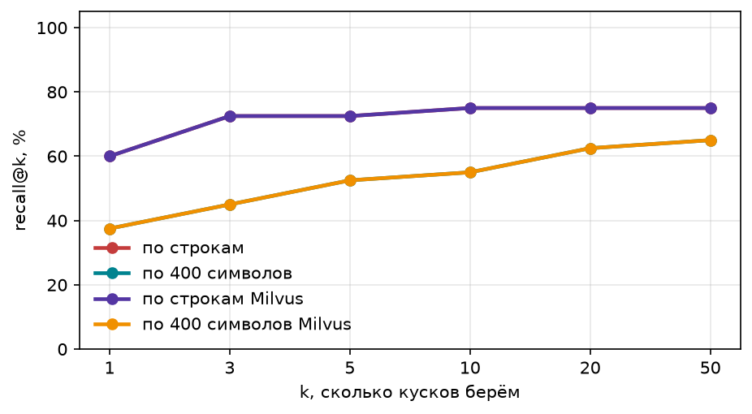
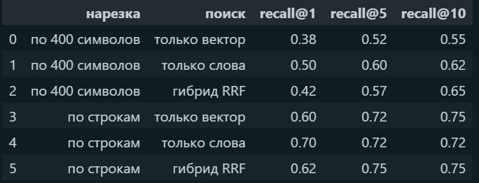
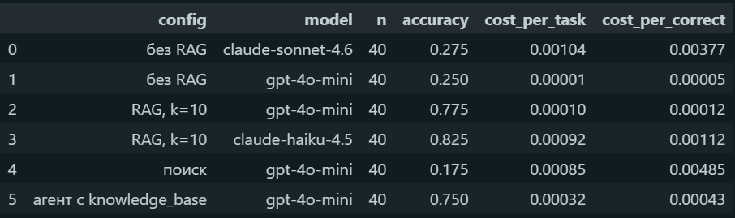
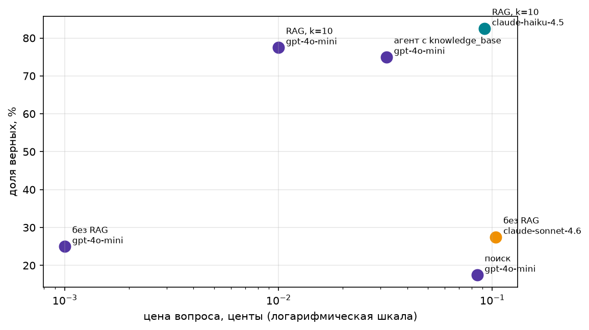
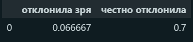
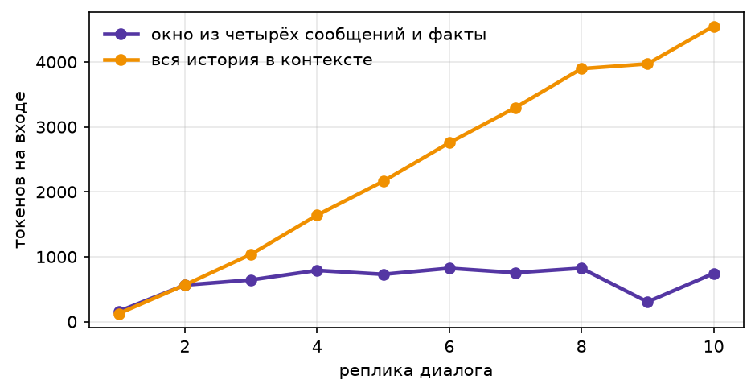

# AI-agent on Fresh Questions
## 1. Агент с инструментами
### Набор
Набор данных расширен новыми и свежими фактами из википедии в разных сферах.
Собирал по несколько вопросов в каждой теме: спорт, наука, новости стран.
Проверка свежести пройдена и результат приведен в img/freshness_criterion.png
### Результаты и вывод
Итоговая таблица и картинка в конце ноутбука test.ipynb

Тезис курса "хороший агент на дешёвой модели обходится дешевле сильной модели в одиночку при том же качестве" подтвердился, поскольку дешевая модель с поиском и чтением справилась за лучшую точность 0.3 и за лучшую стоимость , судя по таблице и графику. Однако время ожидания каждого запроса с инструментами высокое, поскольку приходится применять инструменты, которые не всегда отрабатывают быстро по разным причинам: к примеру, одним из факторов ответа поиска зависит от http запросов.
## 2. RAG и память
### Корпус и вопросы
Корпус состоит из статей о событиях 2026 года в разных странах и разных сферах жизни из Википедии. Он был собран из 30 вопросов из `fresh.jsonl` через `fetch_corpus.py` скрипт, в результате чего найдено 20 страниц, записанных в `corpus_2026.jsonl`. Вопросы по ним находятся в `fresh_2026.jsonl`, кроме того, в этот файл добавлено 10 вопросов БЕЗ ответов на тему корпуса о том, чего в нем нет. Всего 40 вопросов : 30 сгенерировано и 10 записано дополнительно. Структура каждого из них содержит сам вопрос, страницу, цитату, id, источник, ответ.
Замечание: при построении корпуса необходимо исключить вопросы, цитаты которых находятся внутри таблиц викисайтов, так как такой текст не извлекается по запросу.
### Индекс в Milvus и качество поиска
Большинство страниц устроены как список датированных событий: одна строка, одно событие. Отсюда два способа резать. Наивный: по 400 символов, не глядя на границы. Осмысленный: отсекаем куски по разделу на странице, граница проходит до следующей секции, которая начинается со специальных символов "== " и заканчивается на " ==".
Поднимаем векторную базу данных Milvus, чтобы получить следующие преимущества: хранение на диске, метаданные рядом с вектором, фильтры, добавление и удаление без пересборки, индекс для миллионов векторов

По данному графику выбран k = 10, так как это минимальное k, при котором достигается максимальная доля релевантных документов 75%.

Гибрид по строкам дал лучший результат при k = 5, что лучше чем по строкам без rrf
### Результаты

### Разбор провалов
Пример 1. Модель ответила на вопрос ('The sources do not contain information about the temperature'), хотя ей нужно было отклонить вопрос, которого нет в корпусе. Надо менять промпт и выкрутить параметр температуры до нуля
Пример 2. Модель ответила по сути верно на вопрос, кусок найден верно, надо менять проверку, которая нормализует ответ, выкидывая окончания. Правильный ответ : 'A crane collapses onto a passenger train', ответ модели: 'A crane collapse onto a passenger train caused the Sikhio tr'
### Вывод
Верный ответ стоит в 40,4 раза дешевле, когда дешёвая модель получает десять нужных строк вместо всей страницы. Происходит это за счет векторного хранения данных, осмысленной нарезки и правильного выбора количества k кусков
Когда же агент помнит пользователя, а не таскает за собой всю историю,  цена диалога с увеличением количества реплика не превышает 1000 токенов, в то время как в другом случае цена диалога увеличивается почти линейно.
